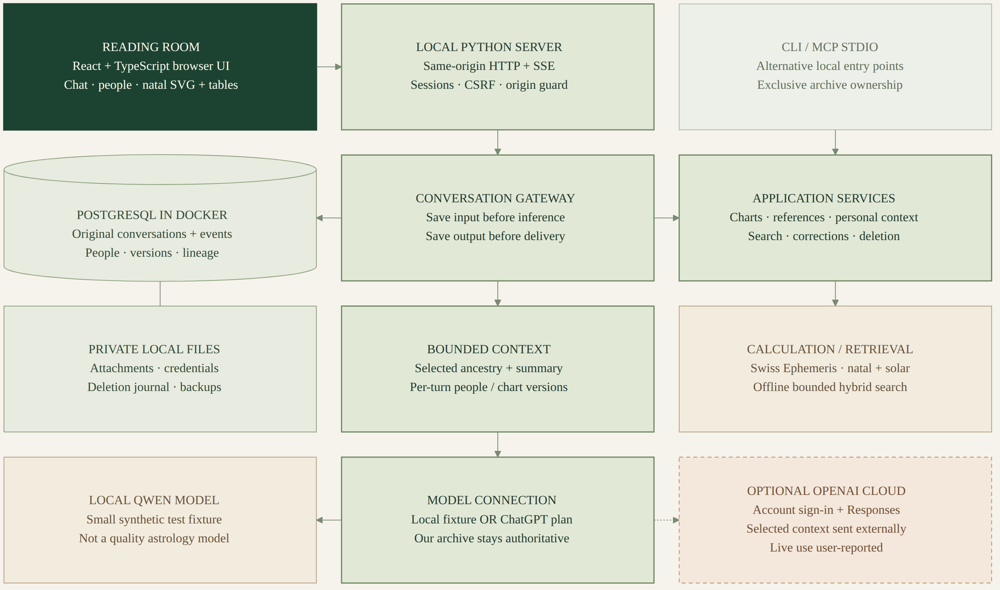

# Katstrology architecture

The diagram below is **historical** (native-natal tip `3a82e36`), not the current deployment or feature inventory. For installed packaging and promotion boundaries, see [deployment](../../deploy/README.md); for current turn and chart contracts, see [the M2 guide](../../m2/README.md).



- [PNG diagram](katstrology.png)
- [Scalable SVG](katstrology.svg)
- [Editable Mermaid source](katstrology.mmd)

## Reading the diagram

The diagram uses a compact three-column, four-row layout. Everything except the
orange dashed OpenAI box runs on the local computer. Arrows show the principal
logical paths, not every internal call; the unarrowed database/files connection
represents related private storage and recovery, not a database calling the
filesystem. The model-connection box includes its optional sign-in adapter.

The browser loads React/TypeScript assets from the same loopback Python server
that handles the API. PostgreSQL is an owned dependency. The app has a container image and a Compose deployment configuration; the local synthetic fixture and deployed runtime are distinct. See [the deployment guide](../../deploy/README.md) for the actual packaging and release checks.

The backend owns workspace authentication, authorization, conversation execution,
context selection and persistence. One serialized Store worker preserves the
current single-process database/transaction boundary. HTTP requests do not each
create a separate independent Store. CLI and MCP are alternative entry points
into shared code, not simultaneously safe writers to the browser's live archive.

The archive retains original messages and ordered events. The conversation path
commits user input before inference and output before browser delivery. The
browser receives committed events and reconnects using a cursor. Selected people
and chart versions belong to each turn; changing today's selection does not
rewrite historical context.

Context assembly uses bounded selected ancestry and an applicable summary rather
than loading the complete archive. Reference/history search and local embeddings
are separate bounded capabilities. Corrections, branch lineage, deletion and
restore validity affect which records are eligible to reappear.

## Models, tools and important limits

- Local chat uses a small Qwen test model. It is a plumbing fixture, not a
  product-quality astrology model.
- The optional OpenAI path uses official account authorization and a direct
  Responses adapter. It does not require a Codex process or separate Codex
  app-server in this implementation. Dashed provider paths/dependencies are
  optional, not proof of a successful live connection.
- Account authorization and model inference are separate: identity sign-in alone
  does not establish permission to use plan allowance. The user reports successful
  live conversations. Agent-run provider tests use synthetic fixtures; this is not
  independent verification of live eligibility, inference or chart-reading quality.
- Selected context is sent to OpenAI in plan mode. Local archive ownership and
  `store: false` must not be described as a guarantee of local-only processing or
  provider zero retention. No provider chat history is imported.
- Hosted Responses can request bounded read-only tools and continue after committed tool results, subject to owner, capacity, cancellation and evidence limits. Browser/CLI/MCP and model reads grant different scopes; the model does not acquire a write/import tool through MCP.
- Native tropical natal charts now provide versioned planetary positions, nodes,
  major aspects and supported Placidus/whole-sign house/angle facts. Exact birth
  time and explicit coordinates are required for full house results; uncertain
  or unsupported quantities remain partial, not invented. The same saved result
  drives the original SVG wheel, accessible tables and selected-chart model
  evidence. See [the natal contract](../../m2/NATAL-CHART.md) for supported dates,
  conventions, numerical references and licensing. Legacy solar methods remain
  available. Other calculations, including transits, relationships and symbolic timing, have their own qualified [method contracts](../../m2/ADVANCED-TECHNIQUES.md).
- Historical person-chart files remain in old archive/backup/deletion data and original turn attribution; there is no new person-file upload, download, deletion route or provider forwarding path. Calculated chart history and generated wheel exports are separate and remain available.
- Reference editions and explicitly selected, bounded model reads are distinct from archived person files. An imported edition is not automatically selected or approved as an interpretive library.
- Files are private runtime state too: attachments, credentials, journals and
  snapshots do not all live inside PostgreSQL. Independent exports/backups have
  their own retention/deletion implications.

These are logical responsibilities inside the existing application, not a
proposal to split it into microservices or evidence of production readiness.

## Source map

| Responsibility | Current implementation |
| --- | --- |
| Mount, session lifetime, workspace navigation and shell | `web/src/main.tsx`, `web/src/app/` |
| Discovery, draft workflow, committed transport/ACK/SSE and turn rendering | `web/src/features/conversation/`; `archive.ts` is the sole sender |
| People, chart workflows and settings | `web/src/features/{people,charts,settings}/` |
| Shared API, theme/style and brand assets | `web/src/shared/` |
| Browser regressions and common assertions | `web/tests/{app,charts,conversation,people,settings,provider,layout,support}/` |
| HTTP/security boundary and serialized lifecycle | `m2/http_boundary/{boundary,runtime,config,app}.py`, `m2/web_server.py` (compatible entry/facade), `m2/web_auth.py` |
| Checked Swiss/time/angle primitives and owner-qualified natal source | `m2/calculation/{ephemeris,time,chart_source}.py`; technique solvers remain separate |
| People, conversation, event and account endpoints | `m2/web_people.py`, `web_conversations.py`, `web_chat.py`, `web_siwc.py` |
| Turn scheduling and commit-before-delivery | `m2/chat_jobs.py`, `gateway.py`, `store.py` |
| Committed-turn selection and qualified evidence | `m2/turn_context.py` (snapshot read), `m2/evidence_links.py` (existing chart/reference command events); `gateway.py` alone sequences archive writes and provider reads |
| Bounded continuity, provenance and retrieval | `m2/recall.py`, `provenance.py`, `evidence.py`, `references.py` |
| Versioned chart records, native natal and legacy solar methods | `m2/charts.py`, `natal.py`, `core_calc.py` (`probes/core_calc.py` is a compatibility re-export) |
| Natal SVG wheel and accessible placement/aspect tables | `web/src/features/charts/natal.tsx` |
| Optional provider authentication/inference | `m2/siwc.py`, `provider_model.py` |
| Private files, deletion and restore | `m2/attachments.py`, `deletion.py`, `backup.py` |
| Alternative local tools | `m2/cli.py`, `fixture_cli.py`, `mcp_server.py` |

The diagram reflects the local implementation through native-natal feature tip
`3a82e36`. It is architecture documentation, not an independent code, numerical,
security or live-provider review. Green boxes are logical responsibilities inside
one application, not additional network services.

## Regenerate

With Mermaid CLI (`mmdc`) and a local Chromium installation:

```sh
mmdc -i docs/architecture/katstrology.mmd \
  -o docs/architecture/katstrology.svg --size 1800 -b '#f5f3ec'
mmdc -i docs/architecture/katstrology.mmd \
  -o docs/architecture/katstrology.png --size 1800 -s 1.5 -b '#f5f3ec'
```

If Chromium is not discoverable, supply `-p /path/to/puppeteer-config.json` with
an `executablePath` appropriate to the machine. Rendering requires no real
workspace data, account credentials or external model request. Images use only
architecture labels, not screenshots of private runtime content.
